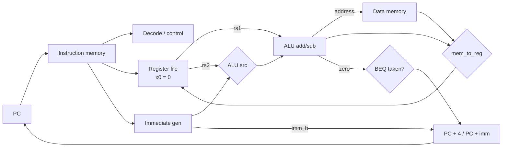

# 05 — Single-Cycle RISC-V Subset CPU (SystemVerilog)

**Status: v0.1.** A single-cycle CPU for `ADD`, `SUB`, `ADDI`, `LW`, `SW`, `BEQ`, simulated with
Icarus Verilog and checked by a self-checking testbench.

**Not done:** pipelining, other ALU ops, JAL/JALR, LUI/AUIPC, byte/half loads, exceptions, FPGA
synthesis, formal checks, timing analysis. No claim is made about area, frequency or power.

## Run it

```bash
sudo apt install iverilog gcc-riscv64-unknown-elf    # Ubuntu / WSL2
cd 05-systemverilog-cpu
make hex     # assemble prog/test.s → prog/test.hex (hex is also committed)
make sim     # compile + run testbench
make wave    # optional: open waveform in GTKWave
```

Expected result (tested with Icarus Verilog 12):
```
ok   : x0 = 00000000
ok   : x1 = 00000005
...
ok   : x9 = 0000002a
ok   : x10 = ffffffff
ok   : dmem[0] = 0000000c
ok   : dmem[1] = 00000002
PASS: all checks passed
```
A harmless `$readmemh ... Not enough words` warning appears because the program is shorter than the 256-word memory (the rest is pre-filled with NOPs).

You can also run the same RTL on [EDA Playground](https://www.edaplayground.com) (choose SystemVerilog + Icarus or Verilator, and paste `cpu.sv`, `cpu_tb.sv` and put the hex in a file named `prog/test.hex`, or inline the program into `imem`).

## Datapath



## Instruction support

| Instr | Encoding | Behaviour |
|-------|----------|-----------|
| ADD  | R, funct7=0000000 | rd = rs1 + rs2 |
| SUB  | R, funct7=0100000 | rd = rs1 − rs2 |
| ADDI | I | rd = rs1 + sext(imm12) |
| LW   | I | rd = dmem[rs1 + imm] (word aligned) |
| SW   | S | dmem[rs1 + imm] = rs2 |
| BEQ  | B | if rs1 == rs2: pc += imm |

Anything else raises the `illegal` output; the testbench asserts it is never raised by the test program.

## Verification

`tb/cpu_tb.sv` runs `prog/test.s` and checks 11 registers, 2 memory words, the final PC, and that `illegal` never fires. It exits non-zero on failure.

**Mutation check** (I deliberately broke the RTL to see whether the testbench notices):

| Injected bug | Caught? |
|--------------|---------|
| SUB acts as ADD | ✅ |
| BEQ branches when *not* equal | ✅ |
| Immediates not sign-extended | ✅ |
| Writes to `x0` take effect | ❌ at first → added `addi x0,x0,123` to the test → ✅ |

The fourth row is the point of the exercise: a passing testbench says nothing until you have seen it fail.

## Known limitations / honest gaps

- One directed test program only. No random or constrained-random stimulus, no coverage measurement.
- Unaligned or out-of-range accesses are not handled (address bits `[1:0]` are ignored; the memory is 256 words, so higher address bits are not range-checked).
- Checks use hierarchical references into the DUT (`dut.regs`). Fine for a learning project, but a real flow checks via a reference model and observable interfaces.
- Reference model idea: reuse `02-riscv-assembly/tools/rv32sim.py` to compare register state after every instruction.

## Next steps

1. Add `AND/OR/SLT/SLL`, `LUI`, `JAL`, `JALR`. Re-run the mutation exercise for each.
2. Write assertions (`assert property`) for "x0 is always 0" and "PC is word aligned".
3. Random program generator + golden model comparison.
4. Split into the 5-stage pipeline in project 04, then add forwarding/hazard unit.
5. Synthesise with Yosys (free) and report cell count, clearly labelled as a rough number.
